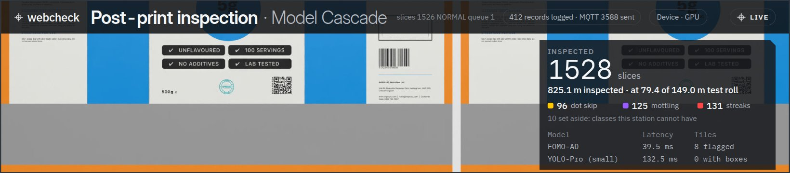
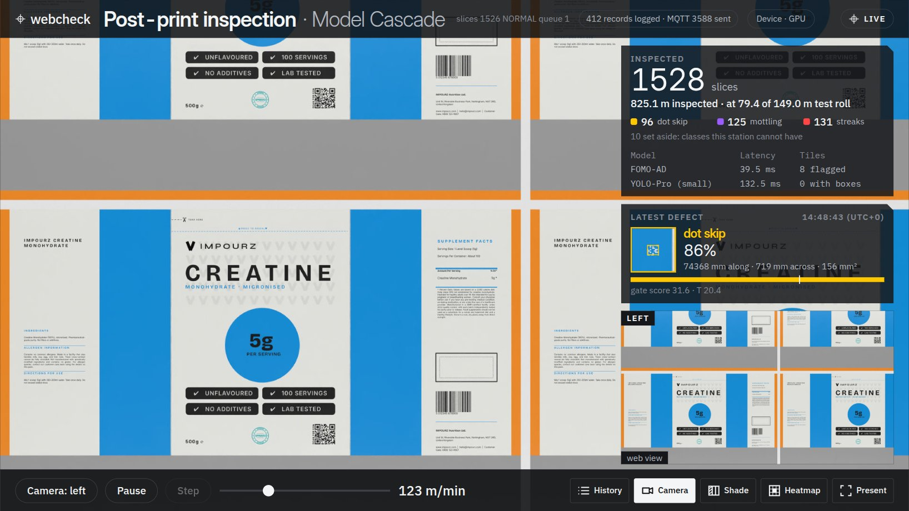
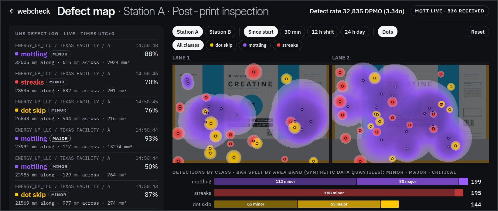
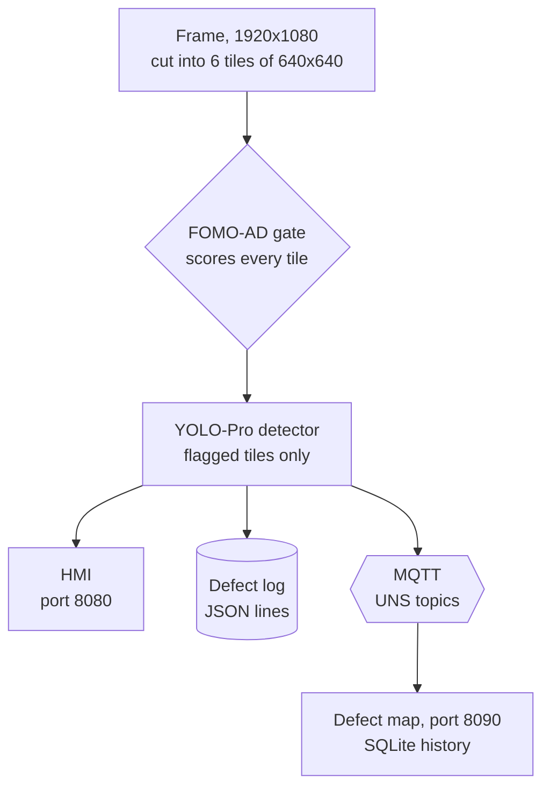

<div align="center">

<picture>
  <source media="(prefers-color-scheme: dark)" srcset="assets/wordmark-dark.svg">
  
</picture>

**Print-defect inspection for flexible-packaging web, at line speed on a Jetson Orin Nano.**

An anomaly gate and a defect detector in cascade, a live operator HMI, and a defect map fed over MQTT.

[](LICENSE)
[](https://www.python.org/)
[](GUIDE.md#what-you-need)
[](GUIDE.md#set-up-the-board)
[](GUIDE.md#without-a-jetson-linux-macos-or-windows)
[](https://studio.edgeimpulse.com/public/1147680/latest)
[](https://huggingface.co/datasets/martinsawojide/webcheck-test-frames)

[Quick start](#quick-start) · [How it works](#how-it-works) · [Screens](#screens) · [Performance](#performance) · [Full guide](GUIDE.md)

<br>



</div>

&nbsp;

> [!NOTE]
> A prototype. The models are trained on synthetic renders of a fictional product, and the demo replays the held-out
> synthetic test frames as if they came off a line. All brands, logos and codes in the artwork are fictional.

## Features

- **Two-stage cascade.** A FOMO-AD anomaly gate scores every tile; only flagged tiles reach a YOLO-Pro detector, which
  names the defect: streaks, dot skip, mottling, tunneling, bubbles or silvering.
- **Operator HMI** (port 8080): the web as the camera sees it, boxed detections, the latest defect, per-class counts,
  model timings, and controls for line speed (1 to 450 m/min), pause, step, camera, gate and detector.
- **Defect map** (port 8090): the defect log streaming live, every detection folded onto one print repeat as a
  per-class heatmap, counts by severity, and the defect rate in DPMO with its sigma level.
- **Unified Namespace over MQTT:** every detection is published on an ISA-95 style topic tree and kept in a
  JSON-lines log.
- **One launcher for Linux, macOS and Windows:** start the demo on the board, or drive the board from a PC over ssh.
- **Runs without a Jetson** through ONNX Runtime on a direct GPU, WebGPU or the CPU, slower, with the same pages.

## Screens

<p align="center">
  
  <br>
  <sub><b>Inspection HMI</b> (port 8080): station A at 123 m/min. Inspected slices and metres, defects per class, the
  latest defect with its gate score, and both models' timings.</sub>
</p>

<br>

<p align="center">
  
  <br>
  <sub><b>Defect map</b> (port 8090): the MQTT defect log streaming live, every detection folded onto one print repeat
  as a per-class heatmap, and counts by class and severity with the defect rate in DPMO.</sub>
</p>

## Quick start

### On a Jetson Orin Nano

You need JetPack 6 (TensorRT 10.3 and `nvcc` come with it), Mosquitto and a free
[Edge Impulse](https://edgeimpulse.com/) account.

```bash
# 1. dependencies and the code
sudo apt install mosquitto mosquitto-clients python3-pil python3-numpy
pip3 install paho-mqtt
git clone https://github.com/MartinsAwojide/webcheck.git && cd webcheck
mkdir -p ~/webcheck_demo/pkg && cp -r src/webcheck ~/webcheck_demo/pkg/
cp scripts/demo_driver.py scripts/defect_map.py scripts/webcheck_demo.py \
   ~/webcheck_demo/

# 2. the synthetic test frames (about 2 GB, checksummed)
python3 scripts/download_test_frames.py --dest ~/test_frames
```

```bash
# 3. the models: in Edge Impulse Studio, clone the two public projects
#    (links below), deploy each impulse as a TensorRT library (float32),
#    unzip it and copy its ONNX files into the demo folder:
#      webcheck_poc_ad, impulse 6 -> onnx_gate6/  trained.onnx, trained_head.onnx
#      webcheck_poc_ad, impulse 7 -> onnx_gate7/  trained.onnx, trained_head.onnx
#      webcheck_poc_od, impulse 5 -> onnx_det5/   trained.onnx
cd ~/webcheck_demo && mkdir -p onnx_gate6 onnx_gate7 onnx_det5
cp <export>/trained.onnx <export>/trained_head.onnx onnx_gate6/   # and so on
```

The projects: [webcheck_poc_ad](https://studio.edgeimpulse.com/public/1147680/latest) (the gates) and
[webcheck_poc_od](https://studio.edgeimpulse.com/public/1136708/latest) (the detector). The optional YOLO-Pro medium
and each click in Studio are in the guide: [Set up the board, step 3](GUIDE.md#set-up-the-board).

```bash
# 4. start (the first start builds the TensorRT engines: several minutes)
cd ~/webcheck_demo && python3 webcheck_demo.py start
```

Open `http://<board>:8080` for the HMI and `http://<board>:8090` for the defect map, on the board or on any machine on
its network. Pick the station, speed, gate and detector on the first screen, then start the line.
`python3 webcheck_demo.py status` and `stop` do the rest.

### From a PC, driving the board

```bash
BOARD=user@jetson make board                 # Linux, macOS
BOARD=user@jetson uv run webcheck-demo board start
$env:BOARD="user@jetson"; uv run webcheck-demo board start   # Windows PowerShell
```

The launcher copies the code to the board over ssh and starts it there. See
[From a PC](GUIDE.md#from-a-pc-linux-macos-or-windows).

### Without a Jetson

```bash
uv sync --extra demo --extra onnx        # add --extra webgpu for WebGPU
uv run webcheck-demo start --dir ~/webcheck_demo --backend onnxruntime --open
```

The splash screen lists the device options this machine has and picks the best. See
[Without a Jetson](GUIDE.md#without-a-jetson-linux-macos-or-windows).

## How it works



Each frame is cut into six tiles. The gate is cheap and runs on all of them; the detector is the expensive model and
runs only where the gate saw something, so a tile the gate passes as normal goes no further. On the Jetson both are TensorRT engines built on the board from Edge
Impulse's ONNX exports; elsewhere ONNX Runtime runs the same files. A slice is never dropped: if the line outruns the
models, the HMI says how far behind it is and catches up.

## Performance

| Machine | Runtime | Result |
|---|---|---|
| Jetson Orin Nano Super, MAXN_SUPER (R4, float32 with TF32, measured) | TensorRT 10.3 | keeps up to 450 m/min; tops out near 15 slices a second (about 490 m/min) |
| the same, with the browser on the board itself (R4, measured) | TensorRT 10.3 | keeps up to 330 m/min |
| Laptop, Core i7-1355U and RTX 2050 (R1, float32, measured) | ONNX Runtime, WebGPU (Vulkan) | about 0.16 s per tile, against about 0.02 s on the Jetson |
| the same laptop, CPU only (R1, float32, measured) | ONNX Runtime, CPU | about 1.5 s per tile, roughly 2 m/min of web |

Measured with the best-F1 gate, YOLO-Pro small, both pages, the defect map and MQTT running. The demo starts with the
best recall gate, the default: it flags more tiles, so it runs slower; pick best F1 on the splash screen for the speeds
above. Off the Jetson, gate scores agree with the board within 0.22 % and the detections are the same on 8 test frames.
A Mac and Windows have not been run yet;
[checking a new machine](GUIDE.md#checking-a-machine-the-project-has-not-run-on) takes one command.

## Documentation

| In the guide | What it covers |
|---|---|
| [What you need](GUIDE.md#what-you-need) | the board, the broker, Python, disk and an optional webcam |
| [Settings](GUIDE.md#settings) | environment variables and the board config file |
| [Using the HMI](GUIDE.md#using-the-hmi) | the splash screen, controls, counters and toggles |
| [What it writes](GUIDE.md#what-it-writes) · [MQTT topics](GUIDE.md#mqtt-topics) | the defect record and the topic tree |
| [How the code is organised](GUIDE.md#how-the-code-is-organised) | every module and its role |
| [Limits](GUIDE.md#limits) · [Troubleshooting](GUIDE.md#troubleshooting) | what the demo does not do, and common fixes |

## Licence

Code: [MIT](LICENSE). The web artwork and the screenshots: CC-BY-4.0. The fonts (IBM Plex, Inter Display): SIL Open
Font License 1.1. See `REUSE.toml` and `LICENSES/`. The test frames are CC-BY-4.0 on
[Hugging Face](https://huggingface.co/datasets/martinsawojide/webcheck-test-frames).
